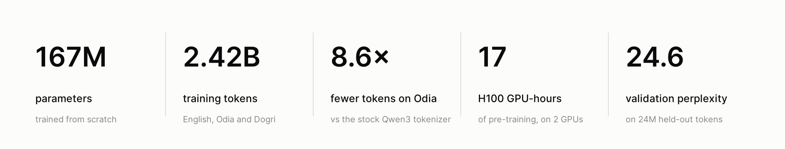
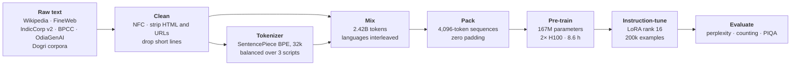
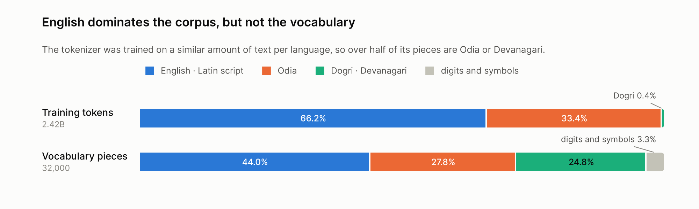
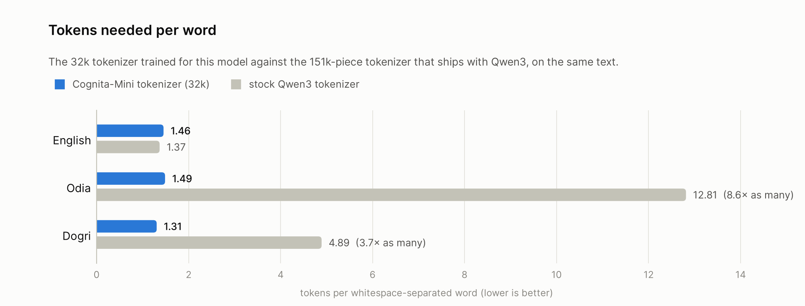
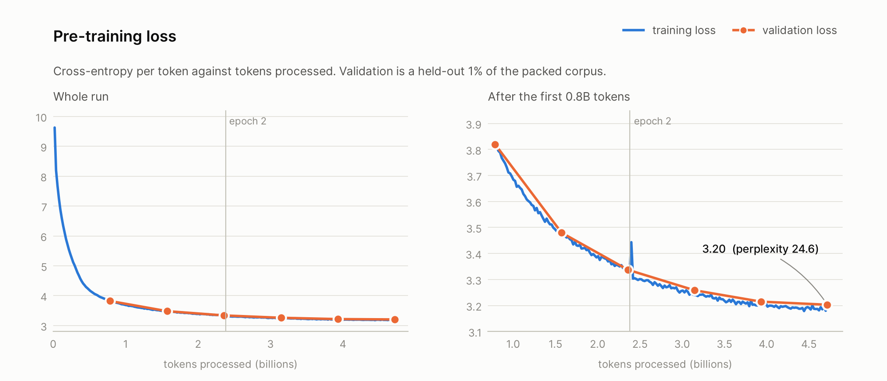
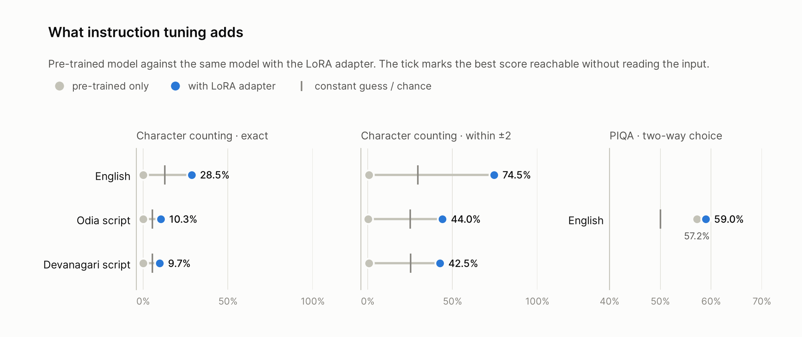

<h1 align="center">Cognita-Mini</h1>

<p align="center">
  <b>A 167M-parameter language model for English, Odia and Dogri, built end to end:</b><br>
  corpus, tokenizer, pre-training from random initialisation, and LoRA instruction tuning.
</p>

<p align="center">
  <a href="https://huggingface.co/ProtonPratt/Cognita-Mini-167M"></a>
  <a href="https://huggingface.co/ProtonPratt/Cognita-Mini-167M-instruct-lora"></a>
  <a href="LICENSE"></a>
  
  
</p>

<p align="center">
  <picture>
    <source media="(prefers-color-scheme: dark)" srcset="assets/hero-dark.png">
    
  </picture>
</p>

<p align="center">
  <a href="#quickstart">Quickstart</a> ·
  <a href="#download">Download</a> ·
  <a href="#results">Results</a> ·
  <a href="#reproduce">Reproduce</a> ·
  <a href="docs/REPORT.md">Technical report</a>
</p>

---

Odia has close to 40 million speakers and Dogri a few million, yet the tokenizers of mainstream
language models serve both poorly. Cognita-Mini is a small model that puts them on an equal footing
with English at the vocabulary level, and a complete, reproducible worked example of every stage that
turns raw text into a model you can talk to.

No pre-trained weights are used anywhere. The network follows the Qwen3 layout, but every parameter
starts from random initialisation and the tokenizer is trained on this project's own corpus.

## Highlights

- **Trained from scratch.** 167,469,952 parameters, 12 layers, a 4,096-token context window, grouped-query
  attention, rotary positions.
- **2.42 billion training tokens** collected, cleaned and mixed from more than a dozen public sources across
  three languages and three scripts.
- **A tokenizer that fits the languages.** One 32k SentencePiece vocabulary shared by Latin, Odia and
  Devanagari script. On Odia text it needs **8.6× fewer tokens** than the tokenizer that ships with Qwen3.
- **Fast, padding-free pre-training.** Token streams are packed into full 4,096-token sequences, giving
  169k tokens per second on two H100s. Two epochs took 8.6 hours.
- **Parameter-efficient instruction tuning.** A rank-16 LoRA adapter (3.2M parameters, 1.9% of the model)
  trained on 200k instructions in three scripts.
- **Every number is reproducible.** The figures and tables below are generated from the JSON files in
  [`results/`](results), which are produced by the scripts in this repository.

<a id="quickstart"></a>
## Quickstart

```bash
pip install "transformers>=4.56,<5" peft torch sentencepiece
```

Continue text with the base model:

```python
from transformers import AutoModelForCausalLM, LlamaTokenizer

repo = "ProtonPratt/Cognita-Mini-167M"
tokenizer = LlamaTokenizer.from_pretrained(repo)
model = AutoModelForCausalLM.from_pretrained(repo)

inputs = tokenizer("ଓଡ଼ିଶା ଭାରତର ଏକ ରାଜ୍ୟ ଯାହା", return_tensors="pt")   # "Odisha is a state of India which"
output = model.generate(**inputs, max_new_tokens=80, do_sample=True, temperature=0.7,
                        top_p=0.8, repetition_penalty=1.1, no_repeat_ngram_size=3)
print(tokenizer.decode(output[0], skip_special_tokens=True))
```

Ask the instruction-tuned model a question:

```python
from peft import PeftModel

model = PeftModel.from_pretrained(model, "ProtonPratt/Cognita-Mini-167M-instruct-lora")
prompt = "### Instruction:\nଭୋକ ଲାଗିଲେ ଲୋକମାନେ ସାଧାରଣତଃ କ'ଣ କରନ୍ତି?\n\n### Response:\n"   # "What do people usually do when hungry?"
inputs = tokenizer(prompt, return_tensors="pt")
output = model.generate(**inputs, max_new_tokens=40, do_sample=False)
print(tokenizer.decode(output[0, inputs.input_ids.shape[1]:], skip_special_tokens=True))   # ଖାଦ୍ୟ ଖାଇବା ("eat food")
```

Or use the command-line tools, which run on CPU as well as GPU:

```bash
python inference/generate.py --prompt "The history of the city begins in the"
python inference/chat.py --instruction "What do people usually do when they are hungry?"
```

<a id="download"></a>
## Download

| Artifact | Size | Link |
|---|---|---|
| Base model, pre-trained from scratch | 670 MB | [ProtonPratt/Cognita-Mini-167M](https://huggingface.co/ProtonPratt/Cognita-Mini-167M) |
| Instruction-tuning LoRA adapter | 13 MB | [ProtonPratt/Cognita-Mini-167M-instruct-lora](https://huggingface.co/ProtonPratt/Cognita-Mini-167M-instruct-lora) |
| Tokenizer (SentencePiece, 32k) | 1.5 MB | [`tokenizer/spm/`](tokenizer/spm) in this repository |

```bash
hf download ProtonPratt/Cognita-Mini-167M --local-dir Cognita-Mini-167M
hf download ProtonPratt/Cognita-Mini-167M-instruct-lora --local-dir Cognita-Mini-167M-instruct-lora
```

## How it was built



| Stage | What happens | Code |
|---|---|---|
| 1. Corpus | Stream, shard, clean and merge text for each language | [`data/`](data) |
| 2. Tokenizer | Sample a balanced subset and train a shared BPE vocabulary | [`tokenizer/`](tokenizer) |
| 3. Pre-training | Pre-tokenize, pack and train the model from random initialisation | [`pretrain/`](pretrain) |
| 4. Instruction tuning | Build and translate the instruction sets, then train a LoRA adapter | [`finetune/`](finetune) |
| 5. Evaluation | Perplexity, character counting and PIQA | [`eval/`](eval) |
| 6. Inference | Text continuation and single-turn chat | [`inference/`](inference) |

## The model

| | |
|---|---|
| Layout | Decoder-only transformer in the Qwen3 design, randomly initialised |
| Layers × width | 12 × 896 |
| Attention | 12 query heads of 128 dimensions sharing 4 key/value heads (grouped-query attention), QK-norm |
| Feed-forward | SwiGLU, 2,048 hidden units |
| Positions | Rotary embeddings (θ = 10,000) |
| Normalisation | Pre-norm RMSNorm |
| Context window | 4,096 tokens |
| Vocabulary | 32,000 pieces, input and output embeddings untied |
| Parameters | 167,469,952 |

Where the parameters live:

| Component | Parameters | Share |
|---|---:|---:|
| Feed-forward blocks | 66,060,288 | 39.4% |
| Attention blocks | 44,040,192 | 26.3% |
| Token embedding | 28,672,000 | 17.1% |
| Output head | 28,672,000 | 17.1% |
| Normalisation | 25,472 | <0.1% |

The vocabulary size is what makes this budget work. With Qwen3's own 151,669-piece vocabulary, the
embedding and output matrices alone would hold 272M parameters, more than this entire model. At 32k
they hold 57M and two thirds of the network is left for the transformer blocks.

## The data

<p align="center">
  <picture>
    <source media="(prefers-color-scheme: dark)" srcset="assets/corpus_and_vocabulary-dark.png">
    
  </picture>
</p>

| Language | Script | Lines | Tokens | Share | Sources |
|---|---|---:|---:|---:|---|
| English | Latin | 2,015,071 documents | 1,602,942,297 | 66.2% | Wikipedia (2023-11 dump), FineWeb (CC-MAIN-2025-26) |
| Odia | Odia | 15,071,896 sentences | 807,950,933 | 33.4% | AI4Bharat IndicCorp v2 and BPCC, eleven OdiaGenAI collections |
| Dogri | Devanagari | 68,105 passages | 10,030,800 | 0.4% | CIIL Dogri corpus, a Dogri Alpaca-style instruction set |
| **Total** | | **17,155,073** | **2,420,924,049** | | |

Token counts are exact and measured with the final tokenizer by
[`pretrain/corpus_stats.py`](pretrain/corpus_stats.py), which scans the pre-tokenized shards and assigns
each line to a language by its script.

Every document goes through the same script-agnostic cleaning: Unicode NFC normalisation (so visually
identical Odia or Devanagari sequences become identical tokens), removal of HTML tags, URLs and control
characters, whitespace collapsing, and a minimum length of six words. The final mix interleaves the
languages line by line in proportion to the tokens each still owes its budget, so no language arrives
in a block. Odia and Dogri are data-limited: the corpus contains every cleaned line that was available.

## The tokenizer

<p align="center">
  <picture>
    <source media="(prefers-color-scheme: dark)" srcset="assets/tokenizer_efficiency-dark.png">
    
  </picture>
</p>

A general-purpose tokenizer shatters Odia into fragments: the stock Qwen3 tokenizer spends 12.8 tokens
on an average Odia word. For a model with a fixed context window and a fixed compute budget, that is an
8.6× tax on everything: context length, training throughput and the amount of language each gradient
step sees.

The Cognita-Mini tokenizer is SentencePiece BPE with 32,000 pieces and 0.9999 character coverage. It is
trained on 100 to 140 MB of text per language, so English cannot crowd the others out of the
vocabulary: 14,076 pieces are Latin, 8,907 Odia and 7,951 Devanagari. All three languages land at 1.3
to 1.5 tokens per word. The price is a 6% increase on English, where the 151k-piece tokenizer is
slightly tighter.

```text
English  This is a sample sentence in English.
         ▁This ▁is ▁a ▁sample ▁sentence ▁in ▁English .

Odia     ଏହା ଓଡ଼ିଆରେ ଏକ ନମୁନା ବାକ୍ୟ ଅଟେ।
         ▁ଏହା ▁ଓଡ଼ିଆ ରେ ▁ଏକ ▁ନମୁନା ▁ବାକ୍ୟ ▁ଅଟେ ।

Dogri    एह् डोगरी च इक नमूना वाक्य ऐ।
         ▁एह् ▁डोगरी ▁च ▁इक ▁नमूना ▁वाक्य ▁ऐ ।
```

The Odia example shows the tokenizer splitting the case suffix `ରେ` ("in") from the stem `ଓଡ଼ିଆ`, the
kind of morphological boundary a subword vocabulary should find.

## Pre-training

<p align="center">
  <picture>
    <source media="(prefers-color-scheme: dark)" srcset="assets/pretraining-dark.png">
    
  </picture>
</p>

| | |
|---|---|
| Objective | Next-token prediction on packed 4,096-token sequences |
| Sequences | 580,932 for training, 5,868 held out (1%, 24M tokens) |
| Effective batch | 192 sequences = 786,432 tokens per update (12 per GPU × 8 accumulation × 2 GPUs) |
| Optimiser | AdamW, weight decay 0.1 |
| Schedule | Peak 3e-4, 1% linear warm-up, cosine decay |
| Precision | bfloat16 autocast |
| Length | 2 epochs, 6,052 updates, 4.76B tokens processed |
| Hardware | 2× NVIDIA H100 (DDP), 8.6 hours wall-clock, 169k tokens per second |
| Result | Validation loss 3.203, **perplexity 24.6** |

Validation loss by checkpoint: 3.820 → 3.480 → 3.337 → 3.259 → 3.215 → 3.203. Training and validation
loss are within about 0.02 of each other at every checkpoint, so two passes over 2.4B tokens do not
overfit a model of this size, and the loss is still edging down when the schedule ends.

Sequence packing matters for throughput. Odia sentences average 54 tokens, so batching them one per row
at a 4,096 width would spend almost every position on padding. Concatenating lines into full sequences
means every position in every batch is a real token.

<a id="results"></a>
## Instruction tuning and results

The base model stays frozen. A LoRA adapter (rank 16, α = 32, dropout 0.05) on every attention and
feed-forward projection adds 3,170,304 trainable parameters, 1.9% of the model, and ships as a 13 MB file.

| Task | Script | Train | Validation | Built from |
|---|---|---:|---:|---|
| Commonsense QA | English | 62,026 | 7,407 | mCSQA, CommonsenseQA, Cosmos QA, PIQA |
| Commonsense QA | Odia | 30,000 | 7,215 | NLLB-200 translation of the English set |
| Commonsense QA | Kashmiri (Devanagari) | 10,000 | 2,405 | NLLB-200 translation, used as a proxy for Dogri |
| Character counting | English | 58,500 | 7,000 | Web sentences with injected characters |
| Character counting | Odia | 30,000 | 7,100 | Synthetic strings over the Odia alphabet |
| Character counting | Devanagari | 10,000 | 2,000 | Synthetic strings over the Devanagari alphabet |
| **Total** | | **200,526** | **33,127** | |

<p align="center">
  <picture>
    <source media="(prefers-color-scheme: dark)" srcset="assets/finetuning-dark.png">
    
  </picture>
</p>

**Character counting.** "How many times does the character `x` appear in ...?" with answers from 0 to
beyond 20. This is a deliberately awkward task for a subword model, which never sees individual
characters, only pieces of words.

| Script | Exact | Within ±2 | Mean abs. error | Best constant guess (exact / ±2) |
|---|---:|---:|---:|---:|
| English | 28.5% | 74.5% | 1.74 | 12.7% / 29.7% |
| Odia | 10.3% | 44.0% | 3.86 | 5.5% / 25.0% |
| Devanagari | 9.7% | 42.5% | 4.25 | 5.5% / 25.4% |

2,000 validation examples per script, greedy decoding. Before tuning the model scores 0% exact match,
because it almost never answers with a number. After tuning it has learned approximate counting in
English and a weaker version of it in the two Indic scripts.

**PIQA** (physical commonsense, two-way choice, 1,838 validation questions). Each candidate solution is
scored by its length-normalised likelihood as the response; chance is 50%.

| Model | Accuracy |
|---|---:|
| Pre-trained only | 57.2% |
| With LoRA adapter | 59.0% |

Both are clearly above chance. The adapter's 1.8-point gain is about the size of the sampling error, so
most of this ability comes from pre-training.

## Samples

Unedited outputs; the base-model samples use `--seed 0` with the defaults of
[`inference/generate.py`](inference/generate.py). The prompt is in bold.

> **The history of the city begins in the** first century, with the city being founded on the site of
> the Romanesque fortress and a Roman villa. The main centre is located at the northern end of the town,
> with an entrance to the ancient city walls that are believed to have been built by the Romans as a
> base for the Roman Empire. …

> **ଓଡ଼ିଶା ଭାରତର ଏକ ରାଜ୍ୟ ଯାହା**ଙ୍କର ନିଜସ୍ୱ ଭାଷା ଓ ସଂସ୍କୃତିକୁ ଆଧାର କରି ସାରା ବିଶ୍ୱରେ ପରିଚିତ ହୋଇଛି । ଏହି ଅବସରରେ
> ପ୍ରଧାନମନ୍ତ୍ରୀ ନରେନ୍ଦ୍ର ମୋଦୀ କହିଛନ୍ତି ଯେ, ଆମ ସମସ୍ତଙ୍କ ପାଇଁ ଏହା ହେଉଛି ଗୌରବର ବିଷୟ। ଆଜି ଆମେ ଏକ ନୂଆ ଅଧ୍ୟାୟ ଆରମ୍ଭ
> କରିବା ଏବଂ ଏହାକୁ ଲାଗୁ କରିବାର ଆବଶ୍ୟକତା ରହିଛି ବୋଲି ସେ କହିଛନ୍ତି। …

> **जम्मू-कश्मीर दे लोकें** दी गिनतरी च एह् बी नेईं ऐ जे ओह् इक गै कम्म करा करदी ऐ। 1. अपने परिवार ते दोस्तें
> कन्नै सहयोग करो: बच्चें गी उंदे कोल कुसै स्थानीय थाह् र पर चुक्की लैओ, … 

The text is fluent and stays in the language and register of the prompt (encyclopedic English, Odia
news prose, Dogri instructional text), and like any model of this size it invents its facts.

With the adapter, the first three short examples of the English counting validation set:

| Instruction | Model | Reference |
|---|---:|---:|
| How many times does the character `7` appear in "Since 2004 to Tonight - Red Sox batters hit 54 Times, MFY's - 61 thanks penny 25 pitches"? | 0 | 0 |
| How many times does the character `5` appear in "5She5 w5ould al5w5ay5s5 wa5n5t55 to 55s5nug5gle"? | 19 | 15 |
| How many times does the character `3` appear in "The book didn't even need Loftus' debunking 3those claim3s - th3ey could not stand up333 o3n their own"? | 5 | 7 |

<a id="reproduce"></a>
## Reproduce

```bash
git clone https://github.com/ProtonPratt/Cognita-Mini-SLM.git && cd Cognita-Mini-SLM
pip install -r requirements.txt
```

<details>
<summary><b>1. Corpus</b></summary>

```bash
# English: 1B budget tokens each from Wikipedia and FineWeb
python data/download_english.py --source wikipedia --out-dir corpus/wikipedia
python data/download_english.py --source fineweb   --out-dir corpus/fineweb

# Odia: IndicCorp v2 text file, then merge with the BPCC and OdiaGenAI dumps
python data/text_to_shards.py --input IndicCorpV2/or.txt --out-dir Odia_sources/indicV2
python data/build_odia_corpus.py --root Odia_sources --out-dir corpus/odia

# Dogri: two sources into one folder
python data/dataset_to_shards.py --dataset StephennFernandes/ciil_mega_corpus_dogri --out-dir corpus/dogri --prefix ciil
python data/dataset_to_shards.py --dataset ./alpaca-dogri-cleaned --out-dir corpus/dogri --prefix alpaca

# Clean everything, then merge the two English sources
for name in wikipedia fineweb odia dogri; do python data/clean_shards.py --input-dir corpus/$name; done
python data/merge_english.py --input-dirs corpus/wikipedia_cleaned corpus/fineweb_cleaned --out-dir corpus/english
```
</details>

<details>
<summary><b>2. Tokenizer</b></summary>

```bash
python tokenizer/sample_corpus.py --input-dir corpus/english       --output english.txt --megabytes 140
python tokenizer/sample_corpus.py --input-dir corpus/odia_cleaned  --output odia.txt    --megabytes 100
python tokenizer/sample_corpus.py --input-dir corpus/dogri_cleaned --output dogri.txt   --megabytes 100
python tokenizer/train_tokenizer.py --input english.txt odia.txt dogri.txt --model-prefix tokenizer/spm/cognita_mini_32k
python tokenizer/inspect_tokenizer.py
```
</details>

<details>
<summary><b>3. Pre-training</b></summary>

```bash
python data/build_pretrain_mix.py --tokenizer tokenizer/spm/cognita_mini_32k.model \
    --corpus english=corpus/english odia=corpus/odia_cleaned dogri=corpus/dogri_cleaned \
    --budget english=1600000000 odia=1200000000 dogri=1200000000 --out-dir corpus/pretrain_mix

python pretrain/pretokenize.py --shards-dir corpus/pretrain_mix \
    --tokenizer tokenizer/spm/cognita_mini_32k.model --out-dir pretrain/tokenized_shards
python pretrain/corpus_stats.py --shards-dir pretrain/tokenized_shards \
    --tokenizer tokenizer/spm/cognita_mini_32k.model

torchrun --nproc_per_node 2 pretrain/train.py --tokenizer tokenizer/spm/cognita_mini_32k.model \
    --shards-dir pretrain/tokenized_shards --output-dir pretrain/checkpoints
```
</details>

<details>
<summary><b>4. Instruction tuning</b></summary>

```bash
python finetune/build_qa_dataset.py --split train      --out-dir ft/qa_train --cosmos-dir cosmosqa/data --piqa-dir piqa/data
python finetune/build_qa_dataset.py --split validation --out-dir ft/qa_val   --cosmos-dir cosmosqa/data --piqa-dir piqa/data
python finetune/build_char_count_dataset.py --mode english --train-size 58500 --val-size 7000 --output-prefix ft/count_en
python finetune/build_char_count_dataset.py --mode odia    --train-size 30000 --val-size 7100 --output-prefix ft/count_or
python finetune/build_char_count_dataset.py --mode dogri   --train-size 10000 --val-size 2000 --output-prefix ft/count_doi

python finetune/jsonl_tools.py sample --input ft/qa_train/combined.jsonl --output ft/to_translate.jsonl --percent 60
python finetune/translate_nllb.py --input ft/to_translate.jsonl --target ory_Orya kas_Deva --gpus 0,1
python finetune/jsonl_tools.py merge --inputs ft/qa_train/combined.jsonl ft/count_en_train.jsonl ... --output ft/train.jsonl

torchrun --nproc_per_node 2 finetune/train_lora.py --base-model pretrain/checkpoints-final \
    --train-file ft/train.jsonl --val-file ft/val.jsonl --output-dir finetune/lora
```
</details>

<details>
<summary><b>5. Evaluation and figures</b></summary>

```bash
python eval/char_count_accuracy.py --base-model ProtonPratt/Cognita-Mini-167M \
    --adapter ProtonPratt/Cognita-Mini-167M-instruct-lora \
    --data english=ft/count_en_val.jsonl odia=ft/count_or_val.jsonl dogri_script=ft/count_doi_val.jsonl --max-examples 2000
python eval/piqa_accuracy.py --base-model ProtonPratt/Cognita-Mini-167M \
    --adapter ProtonPratt/Cognita-Mini-167M-instruct-lora --data piqa/data/valid.jsonl --labels piqa/data/valid-labels.lst
python eval/perplexity.py --model ProtonPratt/Cognita-Mini-167M --data odia=my_heldout_odia.txt

python scripts/make_figures.py        # regenerates every figure in assets/ from results/
```
</details>

Software used for the released run: Python 3.12, PyTorch 2.8.0, Transformers 4.56.1, Datasets 4.1.0,
PEFT 0.17.1, SentencePiece 0.2.1.

## Repository layout

```text
Cognita-Mini/
├── data/          corpus download, cleaning, token counting, language mixing
├── tokenizer/     tokenizer training and analysis, plus the trained 32k model (spm/)
├── pretrain/      model config, pre-tokenization, packing and training
├── finetune/      instruction-set builders, NLLB translation, LoRA training
├── eval/          perplexity, character counting, PIQA
├── inference/     text continuation and single-turn chat
├── scripts/       figures, log export, parameter breakdown, Hub release
├── results/       every measured number, as JSON
├── assets/        figures (light and dark)
└── docs/          technical report and model cards
```

## Limitations

- **Scale.** 167M parameters and 2.4B tokens buy fluent text, not knowledge. Do not rely on anything
  the model states as fact. There is no safety tuning.
- **Dogri is thin.** It makes up 0.4% of the corpus (10M tokens), so Dogri generation is the weakest of
  the three, and its sources lean towards translated instructional text.
- **The "Dogri" instruction data is not Dogri.** NLLB-200 has no Dogri, so the translated QA subset is
  Kashmiri in Devanagari script, and the Odia and Devanagari counting sets are random character strings
  rather than sentences.
- **Question answering is unreliable.** The QA sets were converted from multiple-choice benchmarks to
  open-ended answers, and Cosmos QA questions were kept without their context paragraphs. Free-form
  answers are often plausible but wrong.
- **The released adapter was trained with padding in the loss.** Every example was padded to 4,096
  tokens and all positions were scored, so 98.5% of the training signal was padding and the run took
  13 hours. [`finetune/train_lora.py`](finetune/train_lora.py) now scores response tokens only and pads
  per batch; the original behaviour is kept behind `--legacy-padded-loss`. Retraining with the corrected
  objective is the obvious next step.
- **Validation is in-distribution.** The held-out 1% is drawn from the same shuffled corpus, so
  perplexity 24.6 measures fit to these sources, not transfer to new domains.
- **Tokenizer comparison.** Tokens-per-word figures are measured on 5M characters per language taken
  from the text the tokenizer was trained on.

More detail, including what did not work, is in the [technical report](docs/REPORT.md).

## License and acknowledgements

Code is released under the [MIT License](LICENSE). Model weights are released under
CC BY-NC 4.0, because the instruction data was translated with NLLB-200 (CC BY-NC 4.0) and several
source datasets do not state clear redistribution terms.

This project stands on public data and tools: Wikipedia, FineWeb, AI4Bharat IndicCorp v2 and BPCC,
the OdiaGenAI collections, the CIIL Dogri corpus, mCSQA, CommonsenseQA, Cosmos QA, PIQA, RefinedWeb,
NLLB-200, the Qwen3 architecture, Hugging Face Transformers, Datasets and PEFT, and SentencePiece.

Cognita-Mini started as a course mini-project on building language models end to end. Prarthna Sharma
built it with teammate Pratyush Jena. This repository is the cleaned-up version, with every reported
number measured again from the released weights.

```bibtex
@misc{jenasharma2025cognitamini,
  author = {Sharma, Prarthna and Jena, Pratyush},
  title  = {Cognita-Mini: a 167M-parameter English, Odia and Dogri language model trained from scratch},
  year   = {2025},
  url    = {https://github.com/prarthna2803/Cognita_Mini_SLM}
}
```
